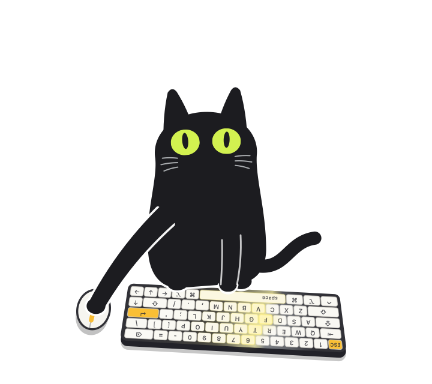

# 哆啦 · Mac 独立桌宠

企业统一授权版从 Octop 左侧“桌宠”入口自动准备并启动，关闭 Octop 后仍可独立运行。超级管理员在企业中心“成员开放权限”中按登录名单选择三个 MCP 和桌宠；成员不用逐人填写业务口令。服务器业务连接只需管理员配置一次，详细流程见 [统一成员开放权限](../docs/custom/central-member-access.md)。

独立的 macOS 应用，自带所需问答引擎与 Python 运行环境，无需另外安装或启动 Octop。Mac 桌宠采用用户确认的 [chanke17/KuroCat 小黑猫](https://github.com/chanke17/KuroCat)，保留原生绘制和键鼠动作。基于 Octop 开源引擎复用已有权限、MCP、专家、Skill 和知识检索能力，不要求用户运行另一款桌面软件。

## 安装包

- [Mac 0.7.4 通用安装包](https://github.com/chaoyang-rao/Octop-custom/releases/tag/dora-macos-v0.7.4)：KuroCat 小黑猫，Intel 和 Apple 芯片通用，默认不吸附屏幕边缘。
- [Windows 0.9.0 小黑猫安装包](https://github.com/chaoyang-rao/Octop-custom/releases/tag/dora-windows-v0.9.0)：KuroCat 原生绘制和键鼠动作，包含独立问答引擎，默认不吸附屏幕边缘。



## 当前能力

- 透明、置顶、可拖动的桌宠；透明区域允许点击穿透，菜单栏左键直接打开对话，右键显示位置、大小、动画和退出操作。
- 小黑猫保留敲键盘、鼠标点击与移动、球面转头、捕猎大圆眼、摸头、睡眠、拖动提起、三键用脚按、四键用尾巴按和键盘跑马灯。右键“小黑猫动作”可单独开关原有彩蛋；“暂停动作”和系统减少动态效果也生效。
- 默认关闭边缘吸附和自动收起，拖放后保持完整姿态。右键“边缘收起”可按需启用，已有明确保存的开关设置继续保留。
- 全局键盘动作需在小猫下方提示或右键“允许小黑猫响应键盘…”中打开 macOS 输入监控设置，勾选哆啦。鼠标跟随及本应用内按键可先使用；输入只在原生动作引擎处理，不进入聊天、模型请求或业务日志。
- 开发构建采用 ad hoc 签名。重建安装后若系统开关已开、小猫仍提示未授权，先退出哆啦，在输入监控中移除旧条目，再重新添加实际安装的 `~/Applications/哆啦.app`；从该安装位置重新启动。请先完成程序更新再重新授权，避免授权仍指向先前构建。
- 右键“宠物大小…”打开连续缩放滑块，支持 50%–250% 实时调节、⌥+滚轮微调和恢复100%。保持脚下中心位置并限制在当前屏幕内，自动记住连续尺寸，兼容原来的三档保存值。
- 双击桌宠打开或收起对话框，或使用 `Control + Option + Space` 呼出对话框；收起小窗保留草稿、会话和正在生成的回答。
- 聊天小窗仅保留对话、输入和右上角“功能与设置”。售后、词元、负利润、知识库四个快捷板块及专家、MCP、知识库、模型、朗读、大小和账号操作统一放在此入口。
- 按住小窗左上“哆啦”或旁边空白拖动窗口；设置按钮、聊天选字和输入框保留各自操作，调整窗口尺寸后仍可拖动。
- 专家与 MCP 可自由组合：可创建本人专家、接入自己的 MCP，再为各板块选择；企业 MCP 始终遵守成员授权。不同板块使用独立会话键，保留原草稿和聊天。
- 拖到显示器外侧边缘后自动收起并露出小猫头部；靠近或点击展开，移开收起，拖离恢复常驻。完整姿态保持 KuroCat 原本的键鼠布局，视线跟随鼠标；相邻显示器边界不触发收起。
- 通过现有企业飞书身份登录；原生登录凭据仅保留在当前进程内，不再自动访问或删除旧钥匙串记录。退出桌宠后，下次使用“企业飞书登录”走正常登录；该客户端自己的登录页面可沿用网站会话，不读取其他程序的浏览器令牌。
- Octop 左侧“桌宠”可自动下载已签名的内部组件、安装到 `~/Applications/哆啦.app` 并启动；旧“账号设置”协议入口保留。当前桌宠支持 macOS。
- 企业超级管理员在“成员开放权限”中按 Octop 登录名单勾选桌宠和三个 MCP。新成员默认不开放；每次新提问重新校验。关闭权限不删除个人专家、历史聊天或记忆。
- 使用引擎原有模型和审批策略。三个企业 MCP 的业务连接由服务器统一保管，成员企业登录后可选择免填额外凭据、令牌或账号密码连接；安装包不携带业务密钥。
- 图片粘贴、选择和拖放；图片通过当前专家的鉴权上传接口存入其工作区。回答中的图片可预览、保存。
- 中文系统语音输入、回答朗读及停止播报。麦克风和语音识别权限仅在用户点击录音时请求，识别文字先进入输入框。
- 回答中的工具和思考过程默认折叠；不同专家的回复保留发言者姓名。
- 支持停止生成、生成中补充、下一条排队及撤回；停止、断线或重新启动后保留待发内容并暂停自动执行。操作确认和选择题追问直接在聊天内处理，沿用专家原有审批策略。
- 消息菜单支持重试、重新回答和编辑后再发，保留原对话。支持图片、Excel（xls/xlsx）、CSV、PDF，每次最多四个、每个不超过 12 MB；原生文件选择器与拖放使用同一类型范围。
- 切换板块、专家、账号或新建会话时，迟到的流式事件不会进入新对话。登录失效、网络断开和上传失败会显示具体状态。

聊天正文和资源保存在桌宠独立数据目录 `~/Library/Application Support/OctopCompanion/Data`；客户端在自己的 WebKit 数据容器中按账号保存板块配置、草稿和会话引用。默认不读取、覆盖或自动迁移原来的 `~/.octop`。个别连接可在本人明确授权后仅在本机导入，密钥重新加密，不进入安装包或企业分发目录。

## 视觉与交互

聊天窗口使用原生磨砂背景与透明 WebKit 内容，支持浅深外观及减少透明度设置。设置页替换聊天区显示，资源/尺寸窗口打开时隐藏聊天主窗。图标、名称、板块和设置与原生关闭按钮同排；窗口自由摆放，桌宠保持在聊天窗上面，收起聊天后再次打开保留位置。

43 张普通动作帧按同一头部尺寸与定位基准注册，探头也共享人物比例；切换姿态不使用窗口缩放补间。内部图帧保持原文件，布局信息写入 `pet.json`。

## 运行边界

安装后只需打开桌宠。首次启动准备内置引擎，随后使用企业飞书登录，按本人权限同步已发布的 MCP、专家及 Skill。引擎仅监听本机回环地址，由桌宠启动并随退出结束；不会连接原 Octop 的 8088 后台。聊天与资源设置从桌宠直接打开。

独立安装不会带入原 Octop 的私有模型密钥、聊天或知识库内容。同一飞书企业的授权成员登录 Octop 或哆啦后自动获得内置词元模型连接，共享上游密钥仅保存在企业服务器；客户端只保存本人企业登录授权。三个企业 MCP 按超级管理员勾选范围开放；知识库支持在桌宠内添加、导入和检索。中央权限和资源更新需要联网。

语音识别依赖 macOS 系统服务及用户授权。识图依赖专家模型具备图像能力；新图片生成需要在桌宠的模型设置中配置并启用生图服务。未配置的服务、未授权的 MCP 会给出具体提示。使用 stdio MCP 时仍须具备对应命令行程序；HTTP MCP 不要求额外运行时。

## 开发与构建

```sh
cd desktop-companion
npm ci
npm test
uv run --project .. python scripts/prepare_engine.py
python3 scripts/build_macos.py
```

构建需要 Node.js 24、Xcode 命令行工具和 uv/Python 3.12+。默认构建包含 arm64 和 x86_64 运行引擎及通用 Mac App 与 DMG，也支持单架构构建。引擎输入来自固定版本、大小与 SHA256 的官方运行时及本仓库源代码，不读取已安装 Octop 的用户数据。

输出位于 `dist/`，可通过 `--output-dir` 指定独立的预览目录。采用 ad hoc 签名，尚未进行 Developer ID 公证。构建脚本运行原生地址校验、小猫动作回归及语音服务冒烟检查，并生成 SHA256 构建记录。Intel 版本可在 Apple 芯片 Mac 上交叉编译，实际 Intel 机器的运行需要单独验收。

独立安装只需取得企业授权分发的 `Dora-macos-universal-*.zip`，解压后将“哆啦.app”放入应用程序目录并打开；不要求预先安装 Octop 主程序。安装包自带双架构引擎和 Python，企业登录、模型及 MCP 仍按本人授权联网使用。

本地运行：

```sh
open dist/哆啦.app --args --show-chat
```

使用方法见应用内“功能与设置 → 使用说明”或 [离线说明文档](HELP.html)。

0.7.0 在“哆啦”旁增加专家与团队快捷选择，原生客户端每次发送前读取获准专家的已保存 MCP 绑定，不接受网页或旧板块的 MCP 覆盖，无需重复勾选。按专家保留会话与草稿，团队仍固定小通主持；Octop 主程序继续支持自建专家和自由配置 MCP。

0.7.1 将“新对话”移到聊天顶栏，齿轮面板仅保留知识库和团队，其余偏好、账号及高级管理移到桌宠右键菜单。专家选择取消黑色外焦点框，保留轻量键盘提示；新对话会清除旧线程标识，同时保留未发送的文本与附件。

0.7.2 更新独立引擎的团队讨论规则：宽泛问题先由成员确认能力与归属，再交叉核对，由小通汇总。专家协作保留各自 MCP、模型和思考设置；已有专家、团队与聊天继续使用。详见[团队讨论说明](../docs/custom/team-deliberation.md)。

0.6.1 发送新消息后将其定位在聊天区顶部，并为流式回复预留空间；历史同步替换消息 ID 后仍保留定位，用户上翻阅读时不会被新输出拉回。原生 WebKit 回归覆盖发送、完成和历史 ID 重新匹配。

0.6.0 在统一入口增加“团队”：可创建团队、选择已有团队并添加本人可用专家，小通固定主持。复用现有 Teams API、主专家身份及成员权限；各成员保留自己的模型/MCP/知识库，独立发言，由小通汇总。团队待发消息需手动继续，避免抢在成员异步回复中间发送下一轮。团队和草稿按本机账号隔离，仍可独立安装与运行。

首次登录按小窗提示使用企业飞书账号。如已有本机账号，先验证并沿用原账号，核对身份关联后继续。

可运行无需登录、不会请求钥匙串的独立引擎启动检查（使用独立的 Acceptance 数据目录）：

```sh
/Applications/哆啦.app/Contents/MacOS/OctopCompanion --preflight
```

登录和真实问答在桌宠界面内验收。进程间不共享原生登录会话，单独运行 `--acceptance-probe` 不会复用正在运行的桌宠凭据。测试对话继续保存在 Octop。

## 角色素材与许可

当前 Mac 小黑猫直接复用 chanke17/KuroCat 的原生 CoreGraphics 绘制、动作物理、键盘映射及输入引擎。固定上游版本与文件校验记录在 `macos/KuroCat/UPSTREAM.json`，原始 MIT 许可保留在同目录 `LICENSE`，安装包附 `KuroCat-LICENSE.txt` 与 `ASSET-NOTICE.txt`。上游应用的独立生命周期、自动更新和联网工坊未接入，客户端继续使用哆啦原有的启动、账号、聊天和分发机制。

Mac 构建不再需要下载或提供内部哆啦A梦图集。Windows 0.9.0 同样不再下载内部角色图集，原生代码与许可由安装包提供；历史素材和记录保留追溯。

Mac 0.7.4 使用 GitHub 的独立安装包发布，通用 DMG 同时支持 Intel 和 Apple 芯片。公开构建工作流会检查源码、动作、聊天窗口及双架构，再准备固定来源的独立引擎并生成安装包与 SHA-256 校验文件。Windows 0.9.0 使用独立发行，采用同一固定上游的Windows原生绘制与动作实现。

## 历史内部立体素材

用户已确认新绘立体版哆啦A梦与拖动起飞、悬停、松手落地效果，限定内部小团队使用。生成素材和含图安装包存放在本机忽略目录，不上传公开仓库；公开工作流仅验证程序源码。原生拖动采用独立状态机，后台工作/语音状态在拖动期间保留，松手后恢复最新状态；起飞和落地片段播放一次，悬停循环，减少动态效果设置保留。

0.7.3 修复 DeepSeek 思考模式在空片段或旧工具记录上的字段回传，保留真实思考与现有会话。汇总失败保留专家成果，明确继续后只恢复失败模型节点，不重放工具或跳过审批。

## Windows 独立版本

Windows 10/11 x64 使用独立的 Electron 窗口，复用相同的聊天界面和专家、团队协议。程序内置 Python 问答引擎，不需要安装 Octop 主程序或另装 Python；与主程序分别保存数据，目录为 `%LOCALAPPDATA%\OctopCompanion\Data`。企业飞书登录后，服务器按当前成员权限同步模型、专家和 MCP，专家绑定无需重复勾选。

Windows 0.9.0 的公开安装包内置KuroCat原生动作进程，通过受限本机像素通道接入独立桌宠窗口；键盘、鼠标数据只用于本地动画。既有登录与桌宠成员权限继续校验，退出或隐藏小猫会停止原生进程；旧角色缓存和聊天数据保留。关闭聊天只隐藏窗口；`Ctrl+Alt+空格`切换聊天，退出请用托盘菜单。卸载保留独立数据目录。中文听写需安装 Windows 中文语音识别语言包，系统麦克风权限与实体设备需另行确认。

构建入口为 `.github/workflows/dora-windows-package.yml`。Windows runner 安装锁定 npm 依赖、运行原生窗口/隔离登录/打断测试、准备独立引擎、编译系统语音桥，再生成 NSIS 安装包及 ZIP，并验证安装后启动和卸载保留数据。隔离协议测试使用原创纯色帧，不使用内部角色素材，也不等同于真实员工飞书登录验收。
